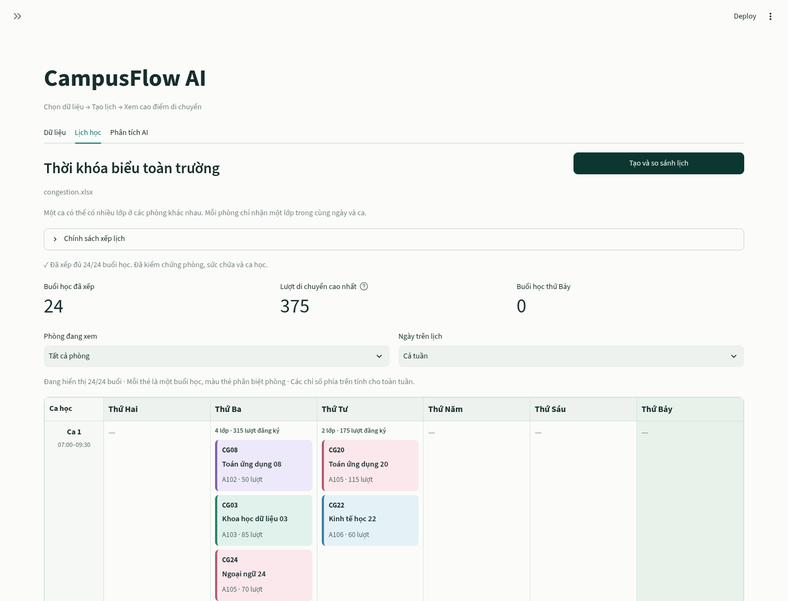
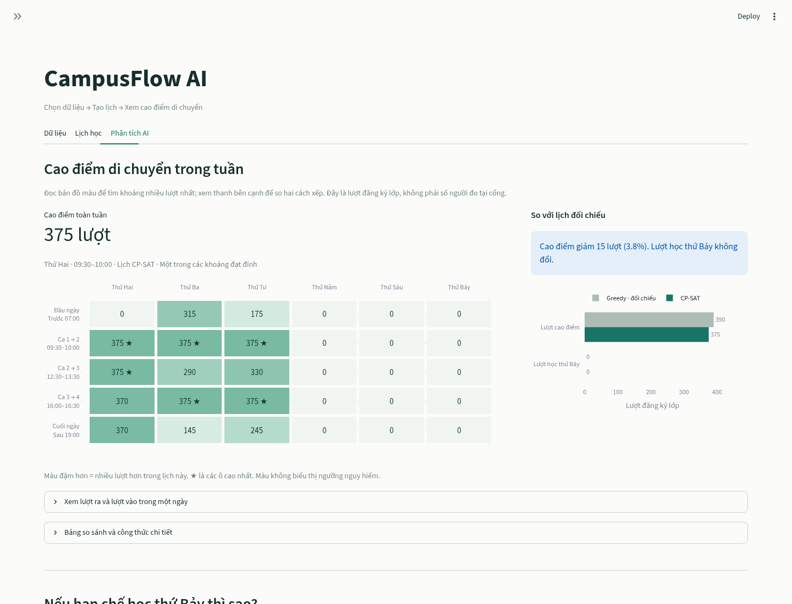

# Báo cáo 2 · Sản phẩm và thực nghiệm

## 1. Tổng quan và chức năng

CampusFlow AI hỗ trợ gán các buổi học vào phòng, ngày và ca trong một tuần mẫu, tối ưu cao điểm di chuyển đại diện và hạn chế thứ Bảy. Công nghệ là Python, Streamlit, OR-Tools CP-SAT, Pandas, Plotly, openpyxl và pytest. Dữ liệu giả lập dùng để kiểm chứng/giải thích, chưa phải dữ liệu đã thu thập tại trường.

Ba tab chính là Dữ liệu (mẫu/import/validation), Lịch học (tạo lịch, bộ lọc phòng/ngày, tải file) và Phân tích AI (heatmap, thanh đối chiếu, luồng ra/vào và ba chính sách thứ Bảy). Có bốn bộ mẫu cố định; bộ sinh theo seed là phần bổ sung sau core.

## 2. Kiến trúc và hợp đồng dữ liệu

`app.py` chỉ khởi tạo và ghép ba tab. `ui/` giữ widgets/state; `workflows.py` điều phối Greedy/CP-SAT và ba chính sách; thuật toán, validator và metrics là các hàm Python không phụ thuộc Streamlit. `data_io.py` lo Excel; `sample_data.py` lo dữ liệu cố định; `presentation.py`/`analysis.py` dựng hình và bảng.

Các dataclass dùng chung gồm ClassSession, Room, Assignment, Dataset, ScheduleConfig, ScheduleResult, ComparisonRun và PolicyExperiment. Kết quả gắn input/config đã dùng để UI không công bố lịch cũ cho chính sách mới. Chi tiết và sơ đồ tại [[01_Dieu_hanh/08_Kien_truc]].

Không có database. Session chỉ là trạng thái trình duyệt; lưu lâu dài hiện qua Excel/CSV do người dùng tải. Source snapshot kèm vault là bản đối chiếu từ `campusflow_demo` tại thời điểm đóng gói. Repo `campusflow` người dùng tự triển khai không được công cụ này chỉnh sửa hoặc mặc nhiên coi là đã kiểm thử.

## 3. Phát biểu bài toán AI

Mỗi bản ghi c là một buổi cần xếp một lần; n_c là số lượt đăng ký. Mỗi phòng r có capacity. Một slot là cặp ngày d và ca s. Chỉ tạo biến nhị phân `x[c,r,d,s]` cho phòng đủ chỗ và ngày/ca hợp lệ.

- H1: với mỗi buổi, tổng các biến ứng viên bằng 1.
- H2: với mỗi phòng/ngày/ca, tổng các biến chiếm phòng không quá 1.
- H3–H4: sức chứa và allowed_days/allowed_sessions được bảo đảm qua miền biến.
- H5: không tạo biến Sunday.
- H6: khi chỉ học ngày thường, loại Sat.
- H7: mọi lịch đầy đủ được kiểm chứng lại bằng Python độc lập.

Hai phòng khác nhau có thể học cùng slot. Không bổ sung ràng buộc sinh viên/giảng viên khi dữ liệu không có các thuộc tính đó.

## 4. Metrics và mục tiêu

`L[d,s] = tổng n_c của các buổi ở ngày d, ca s`.

| Cửa sổ | Lượt rời | Lượt đến | Tổng F |
|---|---|---|---|
| Đầu ngày | 0 | L1 | L1 |
| Ca 1→2 | L1 | L2 | L1+L2 |
| Ca 2→3 | L2 | L3 | L2+L3 |
| Ca 3→4 | L3 | L4 | L3+L4 |
| Cuối ngày | L4 | 0 | L4 |

`P = max F` trên toàn tuần; `N_Sat` là tổng lượt đăng ký các buổi thứ Bảy. Mục tiêu chính: **min J = P + λ × N_Sat**, với λ nguyên không âm. Cấm Sat là hard constraint, còn λ là soft penalty. λ=0 không bắt buộc phải dùng Sat.

Một người học nhiều ca có thể được đếm nhiều lượt. F là tổng theo khoảng thời gian, không phải người xuất hiện cùng một giây, và không đo ùn tắc thực tế. Ghế dư/lấp đầy chỉ được báo cáo, chưa làm tối ưu phụ.

## 5. Thuật toán và tích hợp

Greedy sắp buổi theo số lựa chọn hợp lệ, quy mô giảm dần và mã; chọn phương án có mức tăng J thấp nhất trên lịch một phần, rồi tie-break nhất quán. Không quay lui nên có thể thất bại ngay cả khi tồn tại lịch hợp lệ. Khi thiếu buổi, không có metric chất lượng để so với lịch đầy đủ.

CP-SAT có exactly-one/at-most-one, các biến tải và max equality cho P, rồi tối thiểu hóa J. Lịch Greedy hợp lệ có thể làm hint, không phải constraint. Giới hạn tìm kiếm mặc định 10 giây, một worker, seed 42. Sau giải, assignments được validator/metrics kiểm tra lại.

OPTIMAL là đã chứng minh tối ưu; FEASIBLE mới có lịch hợp lệ; INFEASIBLE là không có lịch trong mô hình; UNKNOWN chưa kết luận; MODEL_INVALID là mô hình sai. Runtime còn gồm chuẩn bị/kiểm chứng nên có thể lớn hơn giới hạn tìm kiếm.

## 6. Dữ liệu và thiết kế thực nghiệm

Bộ Basic có 8 buổi/3 phòng, Congestion có 24/6 tập trung Mon–Wed, Saturday trade-off có 4 buổi ×100/1 phòng cho Mon/Sat, Infeasible có 3 buổi cùng Mon/ca1 nhưng 2 phòng. Chạy thêm Weekdays Only để đối chiếu hard constraint.

Runner `python -m application.experiments --time-limit 10 --output reports/experiments` chạy bảy cấu hình và lưu 14 hàng thuật toán, cùng assignments và provenance. Các kết quả này thuộc bản tham khảo chạy bởi trợ lý; nhóm cần lưu lần chạy riêng trên máy của mình khi nhận việc.

## 7. Kết quả thực tế của bản tham khảo

| Case | λ | Ngày học | Thuật toán | Status | P | N_Sat | J | Giây |
|---|---:|---|---|---|---:|---:|---:|---:|
| basic | 3 | Mon–Sat | Greedy | FEASIBLE | 120 | 0 | 120 | 0.019 |
| basic | 3 | Mon–Sat | CP-SAT | OPTIMAL | 120 | 0 | 120 | 0.086 |
| congestion | 3 | Mon–Sat | Greedy | FEASIBLE | 390 | 0 | 390 | 0.032 |
| congestion | 3 | Mon–Sat | CP-SAT | OPTIMAL | 375 | 0 | 375 | 1.355 |
| saturday-lambda-0 | 0 | Mon–Sat | Greedy | FEASIBLE | 100 | 200 | 100 | 0.001 |
| saturday-lambda-0 | 0 | Mon–Sat | CP-SAT | OPTIMAL | 100 | 200 | 100 | 0.006 |
| saturday-lambda-3 | 3 | Mon–Sat | Greedy | FEASIBLE | 200 | 0 | 200 | 0.001 |
| saturday-lambda-3 | 3 | Mon–Sat | CP-SAT | OPTIMAL | 200 | 0 | 200 | 0.007 |
| saturday-lambda-10 | 10 | Mon–Sat | Greedy | FEASIBLE | 200 | 0 | 200 | 0.001 |
| saturday-lambda-10 | 10 | Mon–Sat | CP-SAT | OPTIMAL | 200 | 0 | 200 | 0.007 |
| weekdays-only | 3 | Mon–Fri | Greedy | FEASIBLE | 200 | 0 | 200 | 0.000 |
| weekdays-only | 3 | Mon–Fri | CP-SAT | OPTIMAL | 200 | 0 | 200 | 0.003 |
| infeasible | 3 | Mon–Sat | Greedy | FAILED | — | — | — | 0.000 |
| infeasible | 3 | Mon–Sat | CP-SAT | INFEASIBLE | — | — | — | 0.002 |

Các hàng thất bại/không kết luận giữ metric trống, không thay bằng 0. Greedy FAILED không chứng minh bài toán vô nghiệm. Cần xem `(P, N_Sat)` khi so các λ, vì J đổi công thức. Những kết quả trên không cho phép khái quát CP-SAT luôn nhanh/tốt hơn hoặc giảm ùn tắc tại trường.

Bộ trade-off có chứng minh nhỏ: chia Mon/Sat, mỗi ngày ca 1 và 3, cho P=100 và N_Sat=200. Chỉ Mon buộc dùng bốn ca, cho P=200 và N_Sat=0. λ cao làm phương án ngày thường được ưu tiên theo mục tiêu đã chọn.

## 8. Kiểm thử và UI

Kết quả pytest được lưu nguyên văn trong log: **107 passed in 18.78s**. Có tính tay F/P/J, lỗi Excel, ràng buộc lịch, phản ví dụ Greedy, vét cạn bài nhỏ, timeout thật, import → solve → export, typed workflows và tương tác Streamlit. Chrome kiểm tra lưới/bảng, lọc phòng/ngày, export đủ lịch, heatmap, ba chính sách và màn hình 390 px.

Ảnh lịch: mỗi thẻ là một buổi, màu giữ ổn định theo phòng; mặc định xem tất cả phòng. Mỗi ô ngày–ca có số lớp và tổng lượt đăng ký đang hiển thị để nhận ra các lớp học song song. Các chỉ số toàn tuần không đổi khi lọc.

Ảnh phân tích: mỗi ô thể hiện F theo ngày/cửa sổ; ★ là các ô đạt P. Thanh đối chiếu và lời giải thích dùng số thực; chi tiết kỹ thuật được thu gọn.

## 9. Vai trò AI và đóng góp của nhóm

Mã tham khảo, UI, tests và tài liệu có hỗ trợ đáng kể từ Codex trong hội thoại hiện tại. Không tự nhận phần đó là A–D đã viết hoặc nghiệm thu. Phần kế hoạch giao việc trong vault là việc nhóm cần nhận, đọc, kiểm chứng và ghi bàn giao thực.

## 10. Hạn chế và hướng phát triển

Chưa xác minh trên máy nhóm/Windows/macOS trừ khi có biên bản bổ sung. Chưa có dữ liệu thật hay danh tính, giảng viên, lịch nhiều tuần, năng lực cổng/đường đi. Không có lưu trữ bền vững; ghế dư chưa tối ưu riêng. Solver có thể chỉ FEASIBLE hoặc UNKNOWN khi timeout.

Hướng phát triển nên bắt đầu từ khảo sát người dùng/quy tắc thực, sau đó bổ sung dữ liệu và ràng buộc có căn cứ. Lưu lịch sử hoặc mục tiêu phụ chỉ được thêm khi có yêu cầu và kiểm chứng tương ứng. Giữ phân biệt proxy với phép đo thực tế.

## Nguồn và việc còn phải chốt

- [ ] Điền lớp, giảng viên, track/rubric và hạn nộp đã xác nhận.
- [ ] Bổ sung lần chạy, nhận xét, đóng góp và biên bản của nhóm.
- [ ] Bổ sung raw transcript AI và rà đủ nguồn.
- [ ] A xác nhận kỹ thuật, D rà hồ sơ rồi mới coi PDF là bản được duyệt.